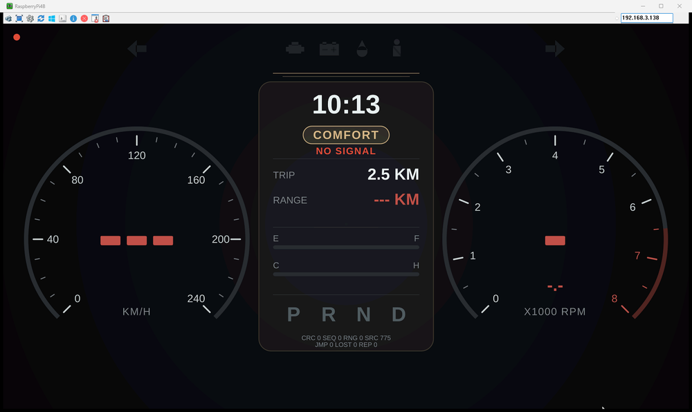
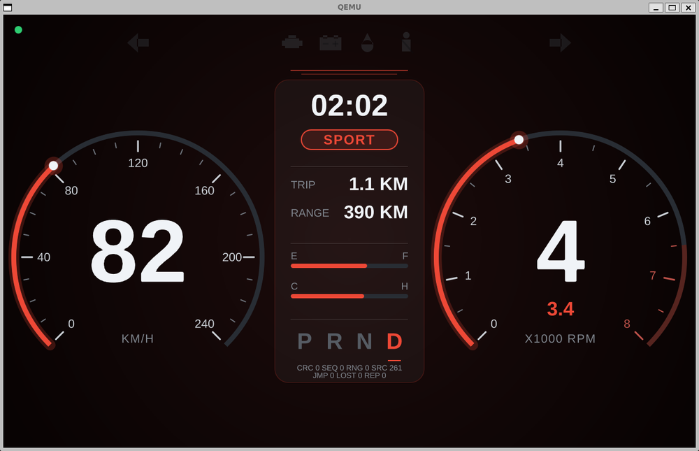

# raspberrypi-qnx-cluster

QNX 8.0과 Qt 6.8.5로 만든 차량 계기판을 **라즈베리 파이 4** 또는 **QEMU VM**에 띄우고, PC의 테스트 콘솔에서 가상 ECU 신호와 진단(DTC, UDS)을 시험하는 개인 학습용 프로젝트입니다.

| 라즈베리 파이 4 (UltraVNC로 본 화면) | QEMU VM |
|---|---|
|  |  |

## 무엇이 들어 있나

- **대상(QNX) 프로그램** (C, Qt Quick)
  - `cluster_gateway`: UDP로 받은 CAN 프레임을 검사하고, E2E 보호(CRC, 카운터)를 붙여 계기판에 전달합니다.
  - `qt_cluster`: 계기판입니다. 받은 값이 이상하면 안전 화면을 띄웁니다.
  - `cluster_diag`: DTC를 파일에 저장하고 UDS 서비스(10, 3E, 22, 19, 14, 27, 11)에 응답합니다.
- **PC 테스트 콘솔** (Python, WSL)
  - 가상 ECU, UDS 클라이언트, 결함 주입, 주행 시나리오, 기록과 재생
  - 시험: 단위 시험, 종단 시험(결함 → DTC), 교차 확인(`udsoncan`, `can-isotp`), 환경 점검,
    주행 시나리오 시험(시나리오 7개를 대상에서 끝까지 돌리며 되읽기, 주행 중 끼어들기 6가지)
- **Windows 런처** `ClusterConsole.exe` (pywebview, PyInstaller)
  - 대상을 고르고, 환경을 점검하고, 빠진 것을 설치한 뒤 콘솔을 엽니다.

## 시작하기

1. [Releases](https://github.com/jeongsemin/raspberrypi-qnx-cluster/releases/latest)에서 `ClusterConsole.exe`를 받습니다.
   프로젝트 파일이 모두 들어 있어 이 저장소를 따로 받을 필요가 없습니다.
   코드 서명이 없어 처음 실행할 때 SmartScreen 경고가 나오면 "추가 정보" → "실행"을 누릅니다.
2. exe를 실행하고 "라즈베리 파이" 또는 "QEMU VM"을 고릅니다.
3. 환경 점검 화면에서 ✕ 항목을 위에서부터 해결하고 "다시 점검"을 누릅니다. 모두 ✓이면 계기판과 테스트 콘솔이 열립니다.

exe가 해 주는 것과 직접 해야 하는 것은 아래와 같습니다. 처음 한 번은 Qt 빌드 때문에 몇 시간 걸립니다.

| | 항목 |
|---|---|
| exe가 자동으로 | 프로젝트 설치, 계기판 빌드, 대상에 Qt 배포, 대상 시작, 콘솔과 VNC 열기 |
| exe 버튼 + 비밀번호 입력 | WSL(관리자 권한), 기본 도구, QEMU와 브리지, `/dev/kvm` 권한, QNX용 Qt 빌드(1~2시간 이상), 파이 SSH 키, 파이 가상 디스플레이 |
| 직접 (exe가 안내하고 "설치 가이드 열기"로 그 단계를 엶) | myQNX 계정과 라이선스, QNX SDP 8.0 설치, QEMU 이미지 받기와 풀기, VM 첫 부팅과 SSH 키 등록, 파이 SD 카드 굽기와 Wi-Fi 설정 |

QNX 계정과 라이선스, SDP는 QNX의 약관에 동의해야 해서 자동으로 할 수 없습니다.
깨끗한 PC에서 처음부터 끝까지 진행해 본 것이 아니라, 이 저장소를 만든 PC에서 항목별로 점검과 고치기를 확인했습니다.

## 문서

| 문서 | 내용 |
|---|---|
| [qnx_cluster/SETUP_GUIDE.md](qnx_cluster/SETUP_GUIDE.md) | 전체 구조와 동작 (먼저 읽기) |
| [qnx_cluster/SETUP_GUIDE_PI.md](qnx_cluster/SETUP_GUIDE_PI.md) | 라즈베리 파이 4 환경 만들기 |
| [qnx_cluster/SETUP_GUIDE_QEMU.md](qnx_cluster/SETUP_GUIDE_QEMU.md) | QEMU VM 환경 만들기 |
| [qnx_cluster/app_launcher/README.txt](qnx_cluster/app_launcher/README.txt) | 런처(exe) 사용법 |

## 폴더

```
qnx_cluster/     계기판, 게이트웨이, 진단, 테스트 콘솔, 런처, 설치 가이드
qt_build/        Qt 6.8.5 받기, PC용·QNX용 빌드, 대상에 배포
qnx_demo/        첫 QNX 예제 (Hello QNX)
screenshots/     예전 단계의 화면 (cluster_display, Qt 계기판)
setup.sh         Ubuntu 홈에 qnx_demo, qnx_cluster 설치
check_env.sh     단계별 튜토리얼용 환경 점검 (단계 번호는 이 저장소에 없는 튜토리얼 기준.
                 설치 가이드를 따를 때는 exe의 환경 점검을 씁니다)
```

## exe 빌드

Releases의 exe 대신 직접 빌드하려면 Windows PowerShell에서 실행합니다(Python, PyInstaller, pywebview 필요).
결과는 `qnx_cluster/app_launcher/dist/`에 생깁니다.

```powershell
& .\qnx_cluster\app_launcher\build_exe.ps1
```

## 들어 있지 않은 것

QNX SDP, QNX 이미지, Qt, 빌드된 실행 파일은 이 저장소에 없습니다. 각자 [QNX Everywhere](https://www.qnx.com) 무료 비상업 라이선스로 SDP를 설치하고, Qt를 직접 빌드합니다. 방법은 위의 설치 가이드에 있습니다.

검증한 환경: Windows 11, Ubuntu 24.04 (WSL2), QNX SDP 8.0, Qt 6.8.5, 라즈베리 파이 4, QEMU (2026-11).
