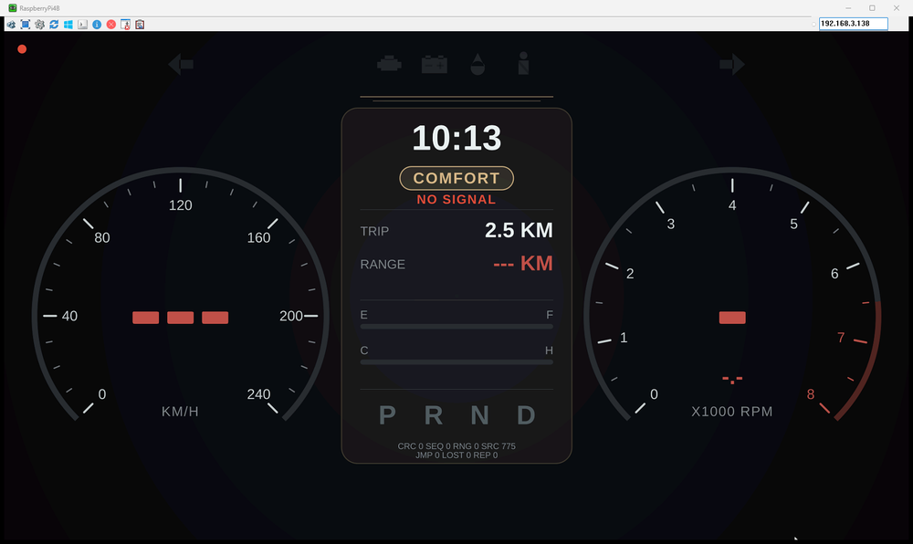
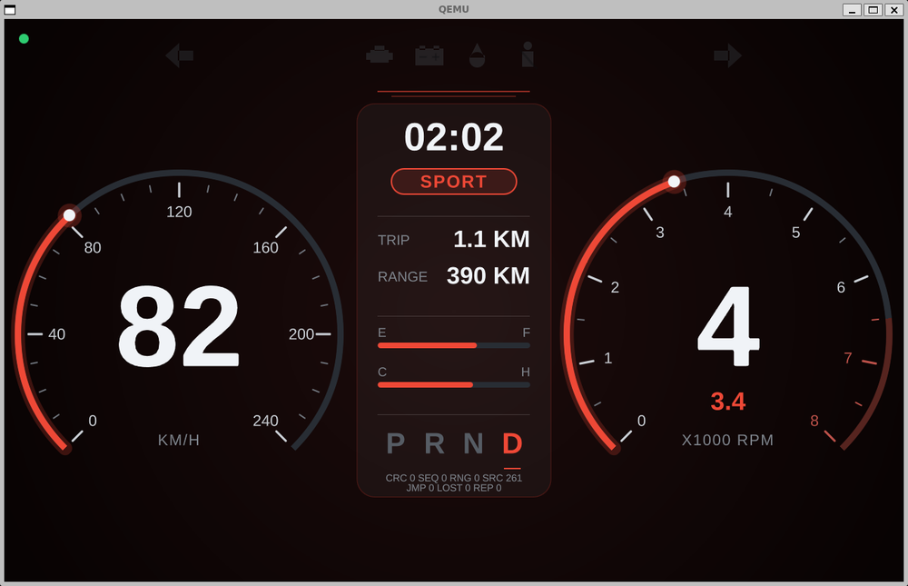
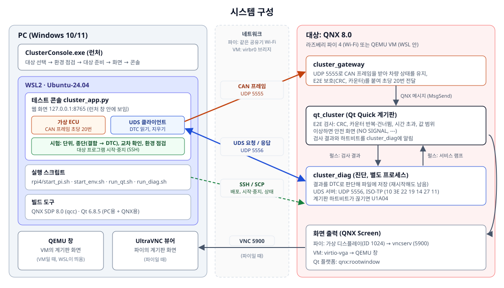
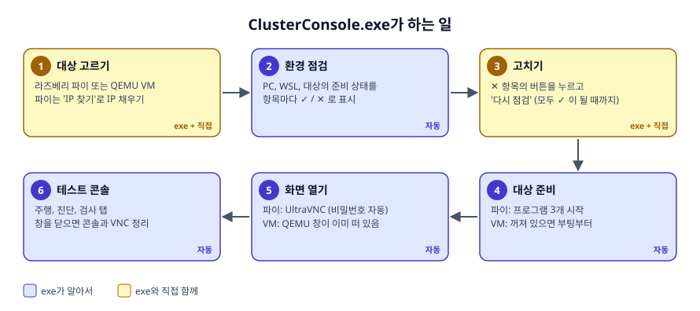
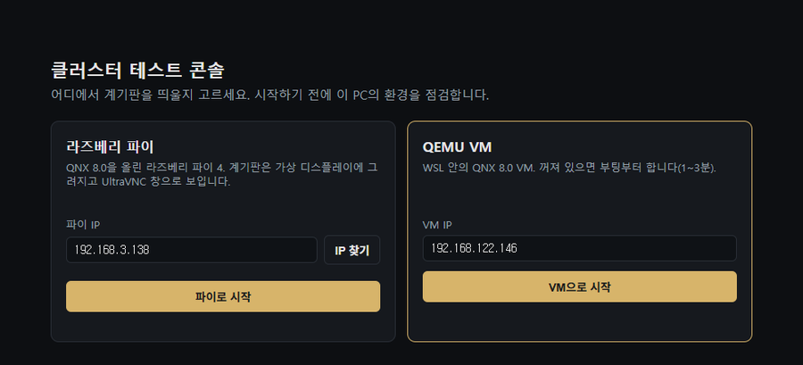
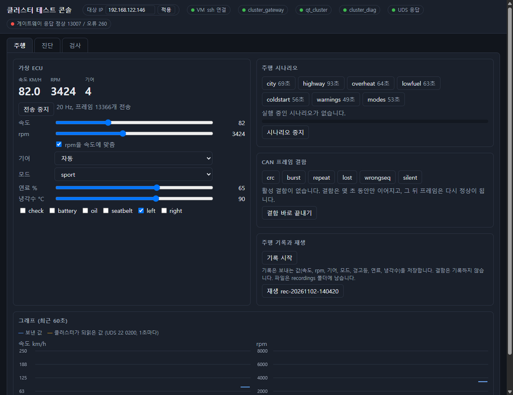
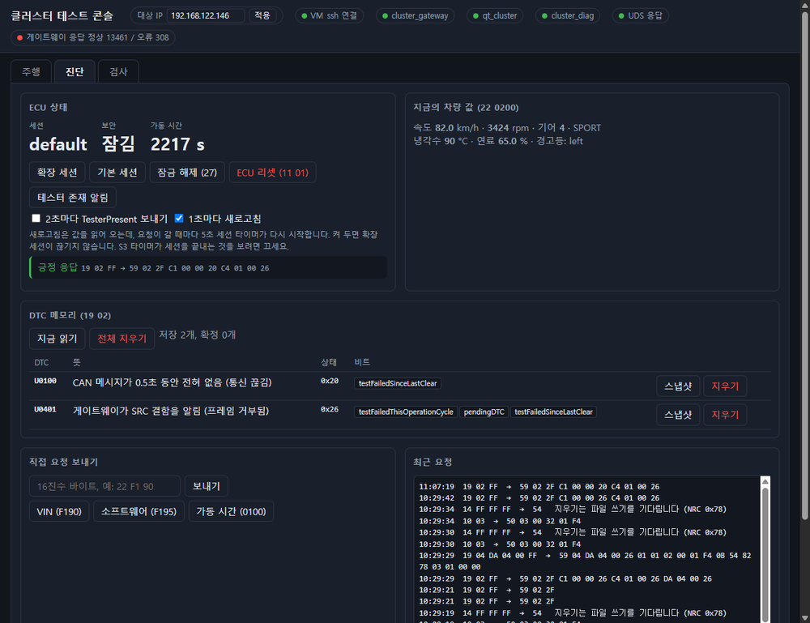
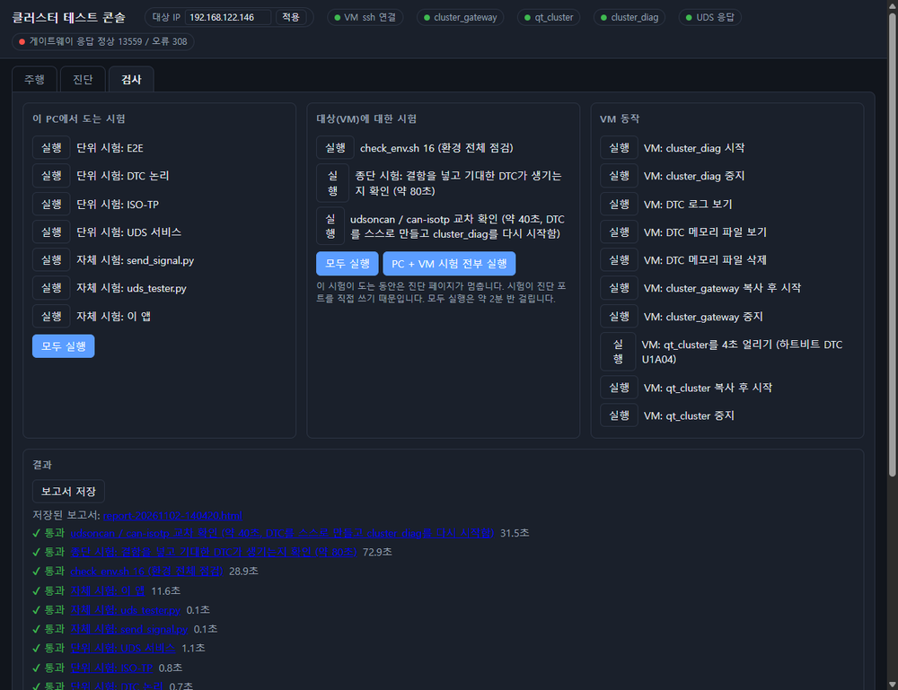
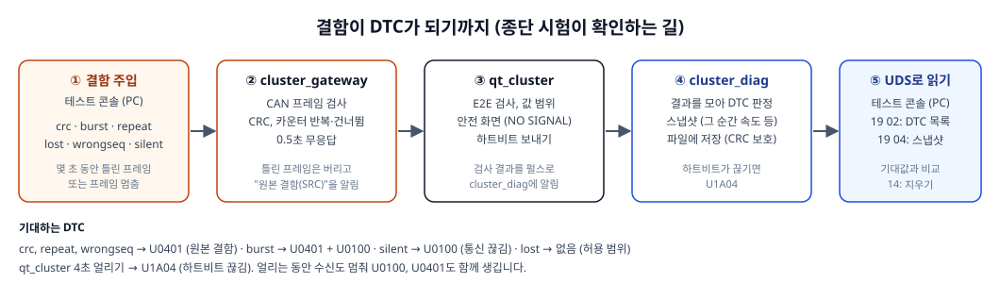

# QNX 계기판 실습 환경: 구조와 동작

QNX 8.0과 Qt 6.8.5로 만든 차량 계기판을 **라즈베리 파이 4** 또는 **QEMU VM**에 띄우고, PC의 테스트 콘솔에서 가상 ECU 신호와 진단(DTC, UDS)을 시험하는 실습 환경입니다.

이 문서는 전체가 **어떻게 동작하는지** 설명합니다. 실제로 설치하는 방법은 대상에 따라 아래 두 문서 가운데 하나를 따라 하세요.

| 대상 | 설치 가이드 | 이럴 때 고르세요 |
|---|---|---|
| 라즈베리 파이 4 | **[SETUP_GUIDE_PI.md](SETUP_GUIDE_PI.md)** | 실제 보드에 띄워 보고 싶을 때. 파이와 SD 카드가 필요합니다. |
| QEMU VM | **[SETUP_GUIDE_QEMU.md](SETUP_GUIDE_QEMU.md)** | 보드 없이 PC 하나로 할 때. 디스크가 더 필요합니다. |

> 개인 학습용입니다. Qt와 QNX 이미지는 들어 있지 않으며, 각자 받아서 빌드합니다.

---

## 1. 무엇을 하는 환경인가

| 실제 차 | 이 실습 |
|---|---|
| 계기판 ECU (QNX + Qt) | 라즈베리 파이 4 또는 QEMU VM 위의 `qt_cluster` |
| CAN 버스로 들어오는 차량 신호 | PC의 **가상 ECU**가 UDP로 보내는 CAN 프레임 (초당 20번) |
| 게이트웨이 ECU | `cluster_gateway`: 프레임을 받아 검사하고 계기판에 전달 |
| 진단 소프트웨어 (DEM, DTC 저장) | `cluster_diag`: 결함을 DTC로 저장, UDS로 응답 |
| 정비소 진단기 | PC의 **테스트 콘솔**: DTC 읽기, 지우기, 결함 주입 시험 |

| 라즈베리 파이 (UltraVNC로 본 화면) | QEMU VM (QEMU 창) |
|---|---|
|  |  |
| 전송 전: 신호가 없어 `NO SIGNAL`, 바늘 대신 `---` (안전 화면) | 시속 82km, 스포츠 모드, 4단으로 전송 중 |

---

## 2. 시스템 구성



### PC 쪽 (Windows + WSL)

| 구성 요소 | 하는 일 |
|---|---|
| `ClusterConsole.exe` | 런처. 대상을 고르고, 환경을 점검하고, 대상 프로그램을 켠 뒤 콘솔을 엽니다. 프로젝트 파일 전체를 안에 품고 있어 WSL에 설치까지 합니다. |
| `cluster_app.py` (WSL) | 테스트 콘솔 서버. 웹 화면(127.0.0.1:8765)을 런처 창 안에 보여 줍니다. |
| 가상 ECU (`app_ecu.py`) | 속도, rpm, 기어, 모드, 경고등, 연료, 냉각수를 CAN 프레임으로 만들어 UDP 5555로 보냅니다. 주행 시나리오, 기록과 재생, 결함 주입을 합니다. |
| UDS 클라이언트 (`app_uds.py`) | UDP 5556으로 ISO-TP 프레임을 주고받아 DTC를 읽고 지웁니다. |
| 시험 (`app_jobs.py`, `app_e2e.py`, `app_scenario.py`) | 단위 시험, 종단 시험, 교차 확인, 환경 점검, 주행 시나리오 시험을 돌리고 대상 프로그램을 SSH로 켜고 끕니다. |
| 빌드 도구 | QNX SDP 8.0의 `qcc`, PC용과 QNX용 Qt 6.8.5. 대상용 실행 파일을 PC에서 크로스 빌드합니다. |

### 대상 쪽 (QNX 8.0)

| 프로그램 | 하는 일 |
|---|---|
| `cluster_gateway` | UDP 5555로 CAN 프레임을 받아 차량 상태를 유지하고, E2E 보호(CRC, 카운터)를 붙여 초당 20번 QNX 메시지로 계기판에 보냅니다. 틀린 프레임은 버리고 "원본 결함"을 알립니다. |
| `qt_cluster` | Qt Quick 계기판. 받은 값을 E2E로 검사하고, 이상하면 안전 화면(NO SIGNAL, `---`)으로 바꿉니다. 검사 결과와 하트비트를 `cluster_diag`에 펄스로 알립니다. |
| `cluster_diag` | 진단 프로세스. 계기판과 따로 돌아서 계기판이 죽어도 DTC가 남습니다. DTC를 CRC가 붙은 파일에 저장하고, UDP 5556에서 UDS 요청(10, 3E, 22, 19, 14, 27, 11)에 답합니다. |
| 화면 출력 | QNX Screen. 파이는 모니터 없이 가상 디스플레이(ID 1024)에 그리고 `vncserv`로 내보냅니다. VM은 QEMU 창에 그립니다. |

---

## 3. 런처가 하는 일





- **환경 점검**은 PC(WSL, 도구, 프로젝트, SDK, Qt, 빌드)와 대상(네트워크, SSH, 화면 설정, Qt 배포)을 차례로 봅니다.
- ✕ 항목에는 고치는 버튼이 붙습니다. "자동으로 고치기"는 exe가 하고, "터미널에서 실행"은 비밀번호가 필요한 명령을 터미널 창에서 실행합니다. 계정 만들기처럼 사람이 해야 하는 일은 안내만 합니다.
- 모두 ✓이면 바로 대상 준비로 넘어갑니다. 다음부터는 몇 분 안에 콘솔까지 열립니다.

---

## 4. 테스트 콘솔

### 주행 탭: 신호 보내기



- **가상 ECU**: "전송 시작"을 누르면 슬라이더 값이 초당 20번 대상으로 갑니다. 계기판 바늘이 따라 움직입니다.
- **주행 시나리오**: 도심, 고속도로, 과열, 연료 부족 같은 정해진 주행을 재생합니다.
- **CAN 프레임 결함**: 몇 초 동안 일부러 틀린 프레임을 보냅니다. 계기판이 어떻게 반응하는지, 어떤 DTC가 생기는지 봅니다.
- **그래프**: 보낸 값과 계기판이 실제로 받은 값(UDS로 되읽음)을 겹쳐 그립니다.

### 진단 탭: UDS로 DTC 읽기



- 세션 바꾸기, 보안 잠금 해제, ECU 리셋 같은 UDS 서비스를 버튼으로 보냅니다.
- **DTC 메모리 (19 02)**: 저장된 DTC와 상태 비트를 읽습니다. "스냅샷"을 누르면 결함이 생긴 순간의 차량 값을 봅니다.
- 위 그림은 `crc` 결함을 넣은 뒤입니다. U0401(원본 결함)과 U0100(통신 끊김)이 기록되었습니다.

### 검사 탭: 시험 전부 실행



| 시험 | 확인하는 것 |
|---|---|
| 단위 시험 (PC) | E2E, DTC 판정, ISO-TP, UDS 서비스 코드를 PC에서 컴파일해 시험 |
| 자체 시험 (PC) | 신호 생성기, UDS 도구, 콘솔 앱 |
| 환경 전체 점검 | 대상의 프로그램, 설정, 네트워크 (파이 42개, VM 49개 항목) |
| 종단 시험 | 결함을 넣고 기대한 DTC가 생기는지 (44개 항목, 아래 그림) |
| 교차 확인 | 공개 라이브러리 `udsoncan`, `can-isotp`로 같은 UDS 서버를 시험해 서로 맞는지 (39개 항목) |
| 주행 시나리오 시험 | 시나리오 7개를 대상에서 끝까지 돌리며 계기판이 받은 값(UDS `22 0200`)이 보낸 값을 따라가는지, 정상 주행 뒤 DTC가 없는지, 주행 중 결함·전송 끊김·계기판 얼림·중지·바꾸기·재생에 기대한 DTC만 생기는지 (120개 항목, 약 11분, 따로 실행: "모두 실행"에는 들어 있지 않음). 파이에서는 Wi-Fi가 0.45초 넘게 멈춘 주행의 U0100/U0401을 `WIFI`로 표시하고 실패로 세지 않습니다. |

---

## 5. 결함이 DTC가 되는 길



- `lost`는 프레임을 3개마다 1개씩 뺍니다. 연속 3개까지는 허용하므로 DTC가 생기지 않아야 합니다.
- 파이는 Wi-Fi로 연결되어, 순간 끊김이 겹치면 `lost`에서 진짜 U0401이 생길 수 있습니다. 그래서 파이에서만 `lost`가 실패하면 한 번 다시 시험하고, 다시 시험한 사실을 결과에 남깁니다. 허용치는 바꾸지 않습니다.

---

## 6. 파이와 VM의 차이

| | 라즈베리 파이 4 | QEMU VM |
|---|---|---|
| CPU 아키텍처 | aarch64le | x86_64 |
| 연결 | 같은 공유기 Wi-Fi | WSL 안의 브리지 (virbr0, 192.168.122.x) |
| 화면 | 가상 디스플레이 → VNC → UltraVNC | QEMU 창 |
| SSH 사용자 | qnxuser (root SSH 막힘) | root |
| Qt 위치 | `/data/home/qnxuser/qt6` | `/data/qt6` |
| 계기판 시각 | 시계는 UTC, 실행 스크립트가 계기판에만 한국 시간을 줌 | 파이와 같음 |
| UDS 응답 시간 (P2) | Wi-Fi 왕복 때문에 클라이언트 1초 | 서버가 알린 50ms |
| 대상 고르기 (스크립트) | `QNX_ARCH=aarch64le` | 기본값 |

---

## 7. 폴더 구성

```
qnx_cluster/
├─ SETUP_GUIDE.md, SETUP_GUIDE_PI.md, SETUP_GUIDE_QEMU.md, guide_images/   이 문서들
├─ cluster_gateway.c, cluster_diag.c, cluster_*.h      대상 프로그램 (C)
├─ qt_cluster/                                        Qt Quick 계기판 (C++, QML)
├─ cluster_app.py, app_*.py, app_ui.html              테스트 콘솔
├─ test_*.c, test_app.py, uds_crosscheck.py           시험
├─ build.sh, qt_cluster/build_qt.sh                   대상용 빌드 (인자: aarch64le)
├─ start_env.sh, run_diag.sh, qt_cluster/run_qt.sh    VM 시작, 대상 프로그램 실행
├─ rpi4/                                              파이 시작, 가상 디스플레이 설정
└─ app_launcher/                                      ClusterConsole.exe 소스와 빌드
../qt_build/                                          Qt 6.8.5 받기, 빌드, 배포
../check_env.sh                                       단계별 튜토리얼용 환경 점검 (설치 가이드에는 exe의 점검)
```

## 이 문서의 검증 범위

2026-11-10에 Windows 11, Ubuntu-24.04(WSL2), QNX SDP 8.0, Qt 6.8.5, 라즈베리 파이 4와 QEMU VM에서 exe로 시작해 모든 시험이 통과했습니다. 그림의 화면은 이때 실제로 찍은 것입니다. 아무것도 설치되지 않은 PC에서 처음부터 끝까지 해 보지는 않았습니다.
