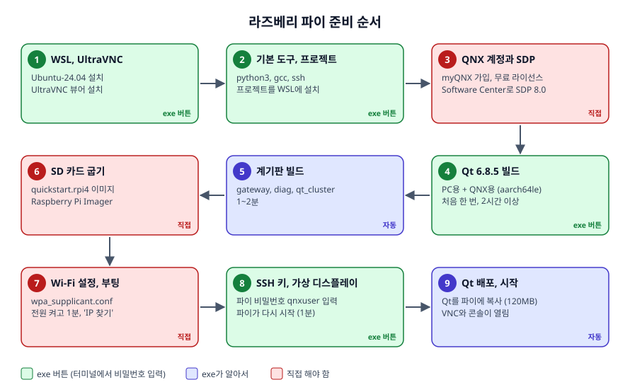
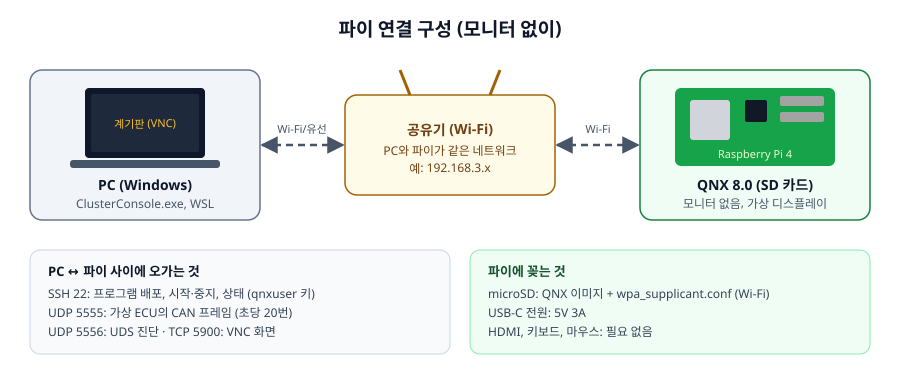
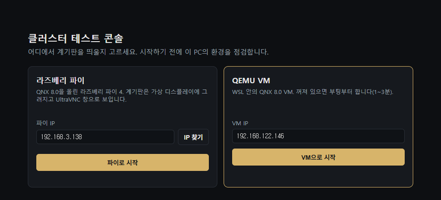
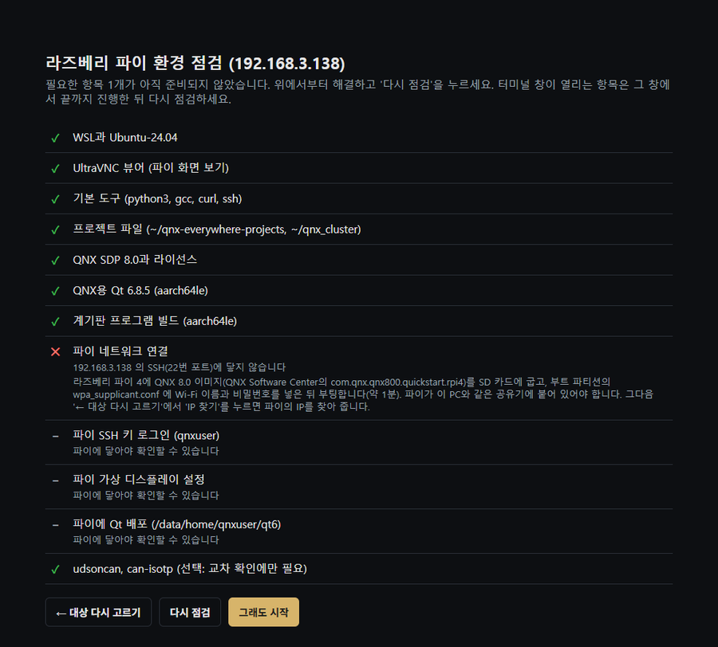
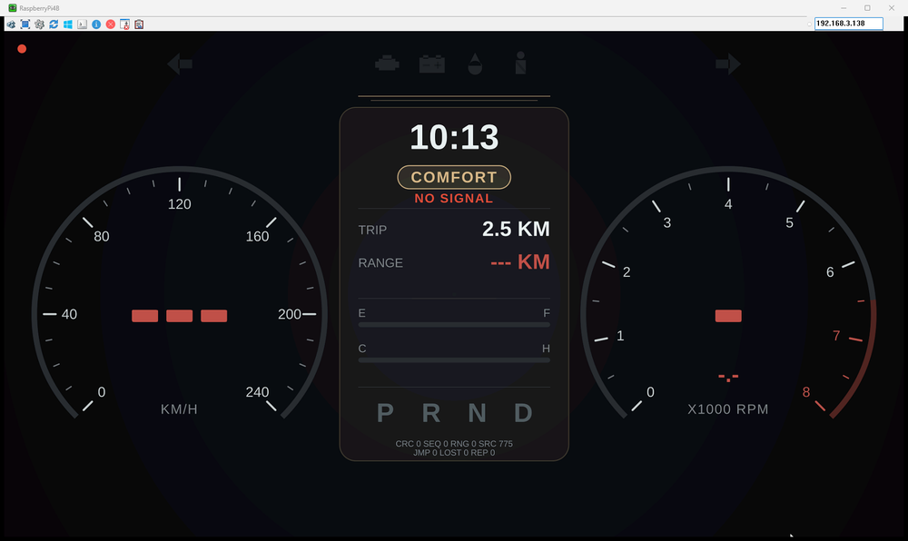
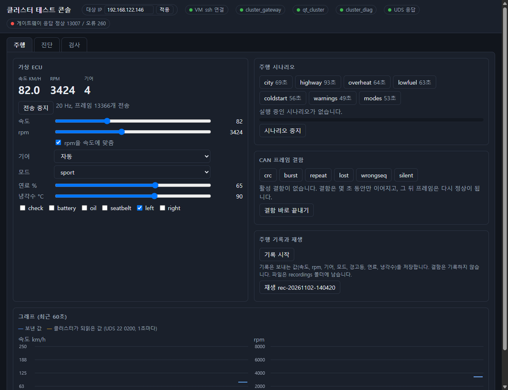

# 설치 가이드: 라즈베리 파이 4

QNX 8.0을 올린 라즈베리 파이 4에 계기판을 띄우는 환경을 처음부터 만듭니다. 계기판은 모니터 없이 파이의 가상 디스플레이에 그려지고, PC의 UltraVNC 창으로 봅니다.

전체 구조와 동작은 [SETUP_GUIDE.md](SETUP_GUIDE.md)에 있습니다. 보드 없이 하려면 [SETUP_GUIDE_QEMU.md](SETUP_GUIDE_QEMU.md)를 보세요.



| 단계 | 시간 | 누가 |
|---|---|---|
| 1~2. WSL, UltraVNC, 기본 도구, 프로젝트 | 10~20분 | exe 버튼 |
| 3. QNX 계정, 라이선스, SDP 8.0 | 30분~1시간 (승인 대기 제외) | 직접 |
| 4~5. Qt 6.8.5 빌드, 계기판 빌드 | 2시간 이상, 처음 한 번 | exe 버튼, 기다리기 |
| 6~7. SD 카드 굽기, Wi-Fi, 부팅 | 30분 | 직접 |
| 8~9. SSH 키, 가상 디스플레이, Qt 배포 | 5분 | exe 버튼 |

---

## 0. 준비물



- Windows 10 또는 11 (64비트), 메모리 16GB 이상 권장, 디스크 여유 약 45GB
- CPU 가상화가 켜져 있을 것: 작업 관리자 → 성능 → CPU → "가상화: 사용"
- 라즈베리 파이 4, 5V 3A USB-C 전원
- microSD 카드 **16GB 이상, 32GB 권장** (이미지가 12.5GB). SanDisk, Samsung, Kingston 같은 잘 알려진 제품
- SD 카드 리더기
- PC와 파이가 **같은 공유기**에 붙을 것. PC가 유선 랜만 쓰고 있다면 그 랜이 파이와 같은 공유기인지 확인하세요. 다른 네트워크면 파이에 닿지 않습니다.
- 모니터, 키보드, 마우스는 필요 없습니다.

---

## 1. exe 실행과 환경 점검

1. `ClusterConsole.exe`와 `README.txt`를 같은 폴더에 둡니다.
2. 처음 실행할 때 **"Windows의 PC 보호"** 창이 뜨면 "추가 정보" → "실행"을 누릅니다. 아예 실행되지 않으면 파일 오른쪽 클릭 → 속성 → "차단 해제" 체크 → 확인.
3. 첫 화면에서 **"파이로 시작"** 을 누릅니다. 아직 준비가 안 되었어도 괜찮습니다. 무엇이 빠졌는지 점검 화면이 알려 줍니다.



점검 화면은 아래처럼 나옵니다. 이 그림은 파이가 꺼져 있을 때의 예입니다. PC 쪽은 모두 ✓이고, "파이 네트워크 연결"이 ✕, 그 뒤 항목은 `–`(아직 확인할 수 없음)입니다.



| 표시 / 버튼 | 뜻 |
|---|---|
| ✓ / ✕ / – | 준비됨 / 빠짐 / 앞 항목이 먼저 필요함 |
| 자동으로 고치기 | exe가 알아서 합니다. |
| 터미널에서 실행 | 검은 창이 열립니다. sudo 비밀번호나 파이 비밀번호를 그 창에 입력하고, 끝나면 Enter로 닫습니다. |
| 설치, 설치 (관리자 권한) | WSL이나 UltraVNC를 설치합니다. |
| (버튼 없음) | 안내대로 직접 합니다. 아래 해당 단계를 보세요. |

✕는 **위에서부터** 하나씩 해결하고, 할 때마다 **"다시 점검"** 을 누릅니다.

---

## 2. WSL, UltraVNC, 기본 도구, 프로젝트 (exe 버튼)

| 항목 | 버튼 | 메모 |
|---|---|---|
| WSL과 Ubuntu-24.04 | 설치 (관리자 권한) | PC를 다시 시작하라고 하면 합니다. 처음 Ubuntu가 열리면 사용자 이름과 비밀번호를 정합니다. **이 비밀번호가 sudo 비밀번호**입니다. |
| UltraVNC 뷰어 | 설치 | winget으로 설치합니다. |
| 기본 도구 | 터미널에서 실행 | python3, gcc, curl, ssh. sudo 비밀번호를 넣습니다. |
| 프로젝트 파일 | 자동으로 고치기 | exe 안의 프로젝트를 WSL의 `~/qnx-everywhere-projects`, `~/qnx_cluster`에 설치합니다. 이미 있으면 `.bak-날짜시각`으로 백업합니다. exe가 바뀌면 다시 ✕가 되어 새 버전으로 바꿀 수 있고, 그때 예전 버전에만 있던 파일은 지우고 빌드한 프로그램은 다시 빌드하게 합니다. |

---

## 3. QNX 계정, 라이선스, SDP 8.0 (직접)

exe가 대신할 수 없는 단계입니다. 계정, 라이선스 신청, 약관 동의는 본인이 직접 합니다.

> **WSL의 Ubuntu에 따로 설치**해야 합니다. Windows용 SDP가 이미 있어도 WSL에서는 쓸 수 없고, 라이선스도 Ubuntu 홈(`~/.qnx/license`)에서 읽습니다.

1. [qnx.com](https://www.qnx.com)에서 **myQNX 계정**을 만들고, **QNX Everywhere 무료 비상업 라이선스**를 신청합니다.
2. [QNX Software Center 다운로드 페이지](https://www.qnx.com/download/group.html?programid=29178)에서 **Linux용** 설치 파일(`qnx-setup-...-linux.run`)을 받습니다.
3. Ubuntu로 복사해 실행합니다. `<Windows사용자>`는 `ls /mnt/c/Users`로 확인한 폴더 이름입니다.

```bash
cp /mnt/c/Users/<Windows사용자>/Downloads/qnx-setup-*-linux.run ~/qnx-setup.run
chmod +x ~/qnx-setup.run && ~/qnx-setup.run
```

   사용권 계약이 나오면 `q`로 끝까지 넘긴 뒤 직접 읽고 동의합니다. `Gtk-CRITICAL` 경고는 무시해도 됩니다.

4. Software Center를 띄웁니다(창이 뜨기까지 20~30초). 창이 하얗게만 보이면 닫고 앞에 `LIBGL_ALWAYS_SOFTWARE=1 GDK_BACKEND=x11`을 붙여 다시 실행합니다.

```bash
nohup ~/qnx/qnxsoftwarecenter/qnxsoftwarecenter > /dev/null 2>&1 &
```

5. myQNX 계정으로 로그인하고, 새 설치로 **QNX Software Development Platform 8.0** (`com.qnx.qnx800`)을 고릅니다. Installation Folder는 `/home/<Ubuntu사용자>/qnx800`, Name은 `qnx800`입니다. 폴더가 `C:\...`로 시작하면 Windows용 창이니 닫습니다. 약 6GB를 받습니다.
6. 같은 Software Center의 **Available** 탭에서 파이 이미지 **`com.qnx.qnx800.quickstart.rpi4`** 도 설치해 둡니다 (6단계에서 씀).
7. 확인합니다. 버전이 나오고, 라이선스 폴더에 파일(`licenses` 등)이 있으면 됩니다.

```bash
source ~/qnx800/qnxsdp-env.sh && qcc -V
ls ~/.qnx/license
```

---

## 4. Qt 6.8.5 빌드 (exe 버튼, 오래 걸림)

"QNX용 Qt 6.8.5 (aarch64le)"에서 **"터미널에서 실행"** 을 누르고 sudo 비밀번호를 넣습니다. 터미널 창이 빌드 도구 설치 → Qt 소스 받기(1GB) → PC용 Qt 빌드 → 파이용 Qt 크로스 빌드(약 70분)를 차례로 합니다.

- **창을 닫지 마세요.** 끊겨도 같은 버튼을 다시 누르면 이어서 합니다.
- 메모리가 16GB인 PC는 먼저 WSL 메모리를 늘리세요. `C:\Users\<사용자>\.wslconfig`에 아래를 적고 PowerShell에서 `wsl --shutdown` 후 다시 시작합니다.

```ini
[wsl2]
memory=11GB
processors=8
swap=8GB
```

<details>
<summary>exe 없이 직접 하려면</summary>

```bash
cd ~/qnx-everywhere-projects/qt_build
sudo apt update && sudo apt install -y build-essential cmake ninja-build pkg-config libgl1-mesa-dev libfontconfig1-dev libssl-dev
bash 1_download.sh
bash 2_host_qt.sh
QNX_ARCH=aarch64le bash 3_qnx_qt.sh
```
</details>

---

## 5. 계기판 빌드 (exe 버튼)

"계기판 프로그램 빌드 (aarch64le)"에서 **"자동으로 고치기"** 를 누릅니다. 1~2분 걸립니다.

선택 항목 "udsoncan, can-isotp"는 시험 가운데 교차 확인에만 필요합니다.

---

## 6. SD 카드 굽기 (직접)

1. Software Center로 받은 `qnx800/images` 아래의 파이 이미지를 찾습니다. 압축되어 있으면 풉니다(약 12.5GB인 `.img`). Windows 탐색기 주소창에 `\\wsl$\Ubuntu-24.04\home\<사용자>`를 넣으면 Ubuntu 안의 파일이 보입니다. 굽기 편하게 Windows 폴더로 복사해 둡니다.
2. 파이에 Raspberry Pi OS가 있었다면, 굽기 전에 그 상태로 부팅해 펌웨어를 올려 두면 좋습니다(QNX 문서 권장): `sudo rpi-eeprom-update -a` 후 `sudo reboot`.
3. [Raspberry Pi Imager](https://www.raspberrypi.com/software/)에서 다음처럼 고르고 굽습니다.

| 항목 | 고를 것 |
|---|---|
| Device | Raspberry Pi 4 |
| OS | 목록 맨 아래 **Use custom** → 받은 `.img` |
| Storage | 새 SD 카드. **크기를 꼭 확인하세요.** USB 드라이브를 고르면 그 안의 내용이 지워집니다. |
| "Use OS customisation?" | **NO** (Raspberry Pi OS용 설정이라 QNX에서는 쓰지 않음) |

---

## 7. Wi-Fi 설정과 부팅 (직접)

1. 다 구우면 카드를 다시 꽂습니다. 부트 파티션이 드라이브로 보입니다.
2. 그 안의 **`wpa_supplicant.conf`** 를 메모장으로 열어(없으면 만들어) PC와 같은 공유기의 Wi-Fi를 적습니다.

```
network={
  ssid="와이파이이름"
  key_mgmt=WPA-PSK
  psk="와이파이비밀번호"
}
```

3. 작업 표시줄의 **"하드웨어 안전하게 제거"** 로 카드를 뺍니다.
4. 카드를 파이에 꽂고 전원을 연결합니다. 부팅에 약 1분 걸립니다.
5. exe에서 **"← 대상 다시 고르기"** → **"IP 찾기"** 를 누릅니다. 같은 네트워크에서 라즈베리 파이를 찾아 IP를 채웁니다.
   - "Raspberry Pi OS(리눅스)로 부팅됨"이 나오면 QNX를 구운 카드가 아닙니다.
   - 공유기에서 파이에 **고정 IP(DHCP 예약)** 를 주면 다음부터 IP가 바뀌지 않습니다.
   - 5GHz Wi-Fi에 붙지 않으면 같은 공유기의 2.4GHz 이름으로 바꿔 보세요.

---

## 8. SSH 키와 가상 디스플레이 (exe 버튼)

"파이로 시작"을 다시 누르면 파이 항목들이 점검됩니다.

| 항목 | 버튼 | 하는 일 |
|---|---|---|
| 파이 SSH 키 로그인 (qnxuser) | 터미널에서 실행 | SSH 키를 만들어 파이에 등록합니다. 파이 비밀번호를 물으면 **`qnxuser`** 를 넣습니다. |
| 파이 가상 디스플레이 설정 | 터미널에서 실행 | 파이의 시작 스크립트를 고쳐, 모니터 없이 화면(Screen ID 1024)을 만들고 VNC로 내보내게 합니다. sudo 비밀번호(**`qnxuser`**)를 넣으면 파이가 다시 시작합니다(약 1분). 원래 파일은 `post_startup.sh.orig`로 남습니다. |

> 파이 기본 계정은 `qnxuser`/`qnxuser`, `root`/`root`입니다. root는 SSH 로그인이 막혀 있어 모든 작업을 qnxuser로 합니다. 같은 네트워크의 다른 사람이 들어오지 못하게 `passwd`로 비밀번호를 바꾸는 것을 권합니다.

---

## 9. Qt 배포와 시작 (exe 버튼)

"파이에 Qt 배포"에서 **"자동으로 고치기"** 를 누르면 Qt 실행 파일(약 120MB)을 파이의 `/data/home/qnxuser/qt6`에 복사합니다.

모든 항목이 ✓이면 exe가 바로 시작합니다.

1. 파이에서 `cluster_gateway`, `qt_cluster`, `cluster_diag`를 켭니다.
2. **UltraVNC 창**이 열립니다. 비밀번호는 exe가 넣습니다.
3. **테스트 콘솔**이 열립니다.



전송을 시작하기 전에는 위처럼 `NO SIGNAL`과 `---`가 보입니다. 신호가 없을 때의 안전 화면입니다. 콘솔에서 "전송 시작"을 누르면 바늘이 움직입니다.



### 동작 확인

1. 콘솔 위쪽 상태 표시(파이 ssh 연결, cluster_gateway, qt_cluster, cluster_diag, UDS 응답)가 모두 초록인지 봅니다.
2. "주행" 탭에서 **"전송 시작"** → 속도 슬라이더를 움직여 VNC 창의 바늘이 따라오는지 봅니다.
3. "검사" 탭에서 **"PC + 파이 시험 전부 실행"** 을 누릅니다(약 3분). 기준: 단위·자체 시험 모두 통과, 환경 점검 42개, 종단 시험 44개, 교차 확인 39개.

> Wi-Fi가 순간 끊기면 종단 시험의 `lost`가 실패할 수 있습니다. 파이에서는 한 번 다시 시험하고, 결과 끝에 "다시 시험한 결함: lost"로 남깁니다.

---

## 10. 다음부터 실행하기

파이 전원 켜기 → 1분 기다리기 → exe 실행 → **"파이로 시작"**. 고르는 화면 없이 바로 시작하려면 바로 가기에 옵션을 붙입니다.

```
ClusterConsole.exe --pi --ip 192.168.0.10
```

끄기:
- 콘솔 창을 닫으면 콘솔과 VNC 창이 닫힙니다. 파이의 프로그램은 계속 돕니다.
- 파이 프로그램까지 끄려면 Ubuntu에서 `cd ~/qnx_cluster && bash rpi4/start_pi.sh stop`.

---

## 11. 자주 생기는 문제

| 증상 | 해결 |
|---|---|
| "IP 찾기"가 파이를 못 찾음 | 파이가 켜진 지 1분이 지났는지, PC와 같은 공유기인지 봅니다. 찾기 결과에 적힌 네트워크(예: `192.168.131.0/24`)가 파이 쪽과 다르면 PC가 다른 네트워크에 붙어 있는 것입니다. |
| "호스트 키가 바뀌었습니다" | SD 카드를 새로 구운 경우입니다. Ubuntu에서 `ssh-keygen -R <파이 IP>` 후 다시 합니다. |
| VNC가 "Screen display dpy-1 not found" | 가상 디스플레이 설정이 안 되었습니다. 8단계 버튼을 다시 누릅니다. |
| VNC 창이 검게 나옴 | 파이 전원을 껐다 켜고 1분 뒤 다시 실행합니다. |
| Qt 빌드가 멈추거나 실패 | 대개 메모리 부족입니다. `.wslconfig`를 적용하고 같은 버튼을 다시 누릅니다. |
| `qcc`가 라이선스 오류 | Software Center에서 라이선스를 받지 않았습니다 (3단계). |
| "counter jumped", 가짜 U0401 | 신호를 보내는 프로그램이 둘 이상입니다. 다른 콘솔이나 `send_signal.py`를 끄세요. |
