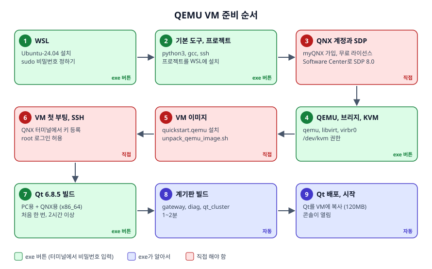
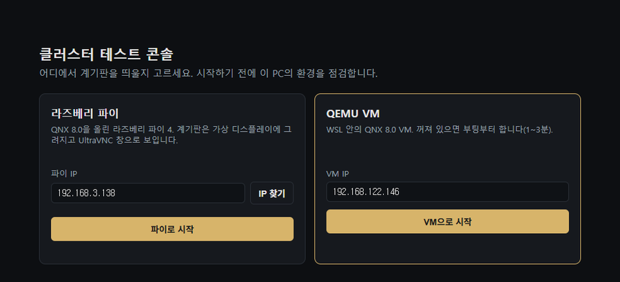
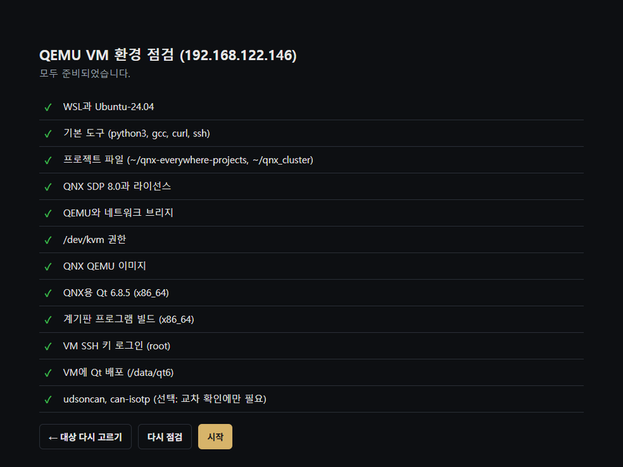
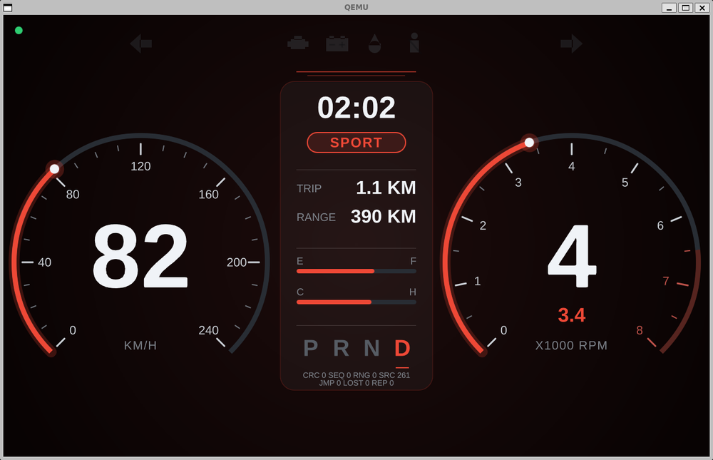
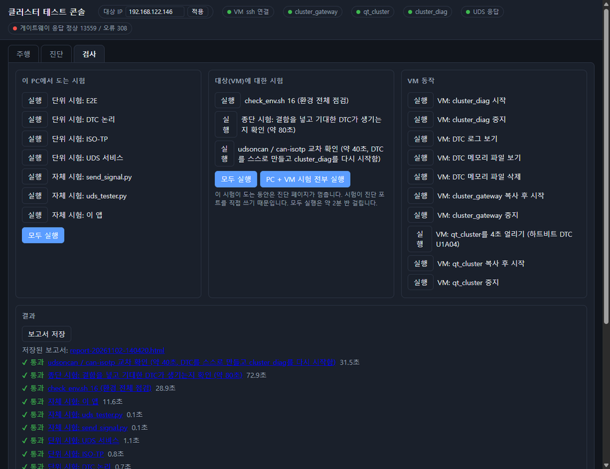

# 설치 가이드: QEMU VM

보드 없이 PC 하나로, WSL 안의 QEMU VM(QNX 8.0)에 계기판을 띄우는 환경을 처음부터 만듭니다. 계기판은 QEMU 창에 보입니다.

전체 구조와 동작은 [SETUP_GUIDE.md](SETUP_GUIDE.md)에 있습니다. 실제 보드로 하려면 [SETUP_GUIDE_PI.md](SETUP_GUIDE_PI.md)를 보세요.



| 단계 | 시간 | 누가 |
|---|---|---|
| 1~2. WSL, 기본 도구, 프로젝트 | 10~20분 | exe 버튼 |
| 3. QNX 계정, 라이선스, SDP 8.0 | 30분~1시간 (승인 대기 제외) | 직접 |
| 4. QEMU, 브리지, KVM | 10분 | exe 버튼 |
| 5~6. VM 이미지, 첫 부팅, SSH | 30분 | 직접 |
| 7~8. Qt 6.8.5 빌드, 계기판 빌드 | 2시간 이상, 처음 한 번 | exe 버튼, 기다리기 |
| 9. Qt 배포와 시작 | 5분 | exe |

---

## 0. 준비물

- Windows 10 또는 11 (64비트), 메모리 16GB 이상 권장
- 디스크 여유 약 95GB: SDP 약 6GB, Qt 빌드 약 35GB, VM 이미지 약 50GB
- CPU 가상화가 켜져 있을 것: 작업 관리자 → 성능 → CPU → "가상화: 사용"
- 인터넷 연결

---

## 1. exe 실행과 환경 점검

1. `ClusterConsole.exe`와 `README.txt`를 같은 폴더에 둡니다.
2. 처음 실행할 때 **"Windows의 PC 보호"** 창이 뜨면 "추가 정보" → "실행"을 누릅니다. 아예 실행되지 않으면 파일 오른쪽 클릭 → 속성 → "차단 해제" 체크 → 확인.
3. 첫 화면에서 **"VM으로 시작"** 을 누릅니다. VM IP는 기본값 `192.168.122.146`을 그대로 둡니다(6단계에서 확인한 IP가 다르면 고칩니다).



모두 준비되면 점검 화면이 아래처럼 됩니다. 처음에는 ✕가 여러 개 있습니다. **위에서부터** 하나씩 해결하고, 할 때마다 **"다시 점검"** 을 누릅니다.



| 표시 / 버튼 | 뜻 |
|---|---|
| ✓ / ✕ / – | 준비됨 / 빠짐 / 앞 항목이 먼저 필요함 |
| 자동으로 고치기 | exe가 알아서 합니다. |
| 터미널에서 실행 | 검은 창이 열립니다. sudo 비밀번호를 그 창에 입력하고, 끝나면 Enter로 닫습니다. |
| 설치 (관리자 권한) | WSL을 설치합니다. |
| (버튼 없음) | 안내대로 직접 합니다. 아래 해당 단계를 보세요. |

---

## 2. WSL, 기본 도구, 프로젝트 (exe 버튼)

| 항목 | 버튼 | 메모 |
|---|---|---|
| WSL과 Ubuntu-24.04 | 설치 (관리자 권한) | PC를 다시 시작하라고 하면 합니다. 처음 Ubuntu가 열리면 사용자 이름과 비밀번호를 정합니다. **이 비밀번호가 sudo 비밀번호**입니다. |
| 기본 도구 | 터미널에서 실행 | python3, gcc, curl, ssh |
| 프로젝트 파일 | 자동으로 고치기 | exe 안의 프로젝트를 WSL의 `~/qnx-everywhere-projects`, `~/qnx_cluster`에 설치합니다. 이미 있으면 `.bak-날짜시각`으로 백업합니다. exe가 바뀌면 다시 ✕가 되어 새 버전으로 바꿀 수 있고, 그때 예전 버전에만 있던 파일은 지우고 빌드한 프로그램은 다시 빌드하게 합니다. |

---

## 3. QNX 계정, 라이선스, SDP 8.0 (직접)

exe가 대신할 수 없는 단계입니다. 계정, 라이선스 신청, 약관 동의는 본인이 직접 합니다.

> **WSL의 Ubuntu에 따로 설치**해야 합니다. Windows용 SDP가 이미 있어도 WSL에서는 쓸 수 없고, 라이선스도 Ubuntu 홈(`~/.qnx/license`)에서 읽습니다.

1. [qnx.com](https://www.qnx.com)에서 **myQNX 계정**을 만들고, **QNX Everywhere 무료 비상업 라이선스**를 신청합니다.
2. [QNX Software Center 다운로드 페이지](https://www.qnx.com/download/group.html?programid=29178)에서 **Linux용** 설치 파일(`qnx-setup-...-linux.run`)을 받습니다.
3. Ubuntu로 복사해 실행합니다. `<Windows사용자>`는 `ls /mnt/c/Users`로 확인한 폴더 이름입니다.

```bash
cp /mnt/c/Users/<Windows사용자>/Downloads/qnx-setup-*-linux.run ~/qnx-setup.run
chmod +x ~/qnx-setup.run && ~/qnx-setup.run
```

   사용권 계약이 나오면 `q`로 끝까지 넘긴 뒤 직접 읽고 동의합니다. `Gtk-CRITICAL` 경고는 무시해도 됩니다.

4. Software Center를 띄웁니다(창이 뜨기까지 20~30초). 창이 하얗게만 보이면 닫고 앞에 `LIBGL_ALWAYS_SOFTWARE=1 GDK_BACKEND=x11`을 붙여 다시 실행합니다.

```bash
nohup ~/qnx/qnxsoftwarecenter/qnxsoftwarecenter > /dev/null 2>&1 &
```

5. myQNX 계정으로 로그인하고, 새 설치로 **QNX Software Development Platform 8.0** (`com.qnx.qnx800`)을 고릅니다. Installation Folder는 `/home/<Ubuntu사용자>/qnx800`, Name은 `qnx800`입니다. 폴더가 `C:\...`로 시작하면 Windows용 창이니 닫습니다. 약 6GB를 받습니다.
6. 확인합니다. 버전이 나오고, 라이선스 폴더에 파일(`licenses` 등)이 있으면 됩니다.

```bash
source ~/qnx800/qnxsdp-env.sh && qcc -V
ls ~/.qnx/license
```

---

## 4. QEMU, 네트워크 브리지, KVM (exe 버튼)

| 항목 | 버튼 | 하는 일 |
|---|---|---|
| QEMU와 네트워크 브리지 | 터미널에서 실행 | QEMU, libvirt를 설치하고 VM용 브리지(virbr0, 192.168.122.x)를 켭니다. |
| /dev/kvm 권한 | 터미널에서 실행 | `sudo chmod 666 /dev/kvm`. **WSL을 다시 시작할 때마다 필요합니다.** |

---

## 5. VM 이미지 (직접)

1. Software Center의 **Available** 탭에서 `quickstart`를 검색하고, **QEMU용** `com.qnx.qnx800.quickstart.qemu`를 설치합니다(약 2.5GB). `rpi4`, `rpi5` 항목은 고르지 않습니다.
2. Ubuntu에서 이미지를 풉니다. 수 분 걸리고 약 48GB가 생깁니다.

```bash
cd ~/qnx800/images/qemu && ./unpack_qemu_image.sh
ls ~/qnx800/images/qemu/qemu/output
```

`ifs.bin`과 `disk-qemu.vmdk`가 보이면 됩니다.

---

## 6. VM 첫 부팅과 SSH (직접)

VM에 SSH 키를 한 번 등록해야 exe가 VM을 다룰 수 있습니다. Ubuntu 터미널 두 개(A, B)를 씁니다.

> **VM을 직접 띄우는 것은 이 단계에서 한 번만 하세요.** `mkqnximage --run`을 쓸 때마다 디스크 설정 파일(`disk-qemu.vmdk`)에 줄이 하나씩 쌓여, 20번쯤 쓰면 VM이 부팅되지 않습니다. 다음부터는 exe(또는 `start_env.sh`)로 켜면 부팅 전에 이 파일을 점검하고 고칩니다.

### 6-1. VM 띄우기 (터미널 A, VM이 켜져 있는 동안 닫지 않음)

```bash
source ~/qnx800/qnxsdp-env.sh
cd ~/qnx800/images/qemu/qemu
sudo chmod 666 /dev/kvm
LIBGL_ALWAYS_SOFTWARE=1 GALLIUM_DRIVER=llvmpipe mkqnximage --run
```

- 앞의 `LIBGL_ALWAYS_SOFTWARE=1 GALLIUM_DRIVER=llvmpipe`는 소프트웨어 렌더링입니다. 빼면 그래픽 드라이버 문제로 QEMU가 꺼질 수 있습니다.
- 처음에 `qemu-bridge-helper not setuid`와 함께 sudo 비밀번호를 물을 수 있습니다. 넣으면 됩니다.
- QNX 화면 창이 열리고 환영 화면이 보이면 부팅된 것입니다.

### 6-2. IP 확인과 SSH 키 만들기 (터미널 B)

부팅 후 1~2분 기다립니다.

```bash
source ~/qnx800/qnxsdp-env.sh
cd ~/qnx800/images/qemu/qemu && mkqnximage --getip
mkdir -p ~/.ssh && chmod 700 ~/.ssh
[ -f ~/.ssh/id_ed25519 ] || ssh-keygen -t ed25519 -N "" -f ~/.ssh/id_ed25519 -C "qnx-qemu"
```

`192.168.122.xxx`가 나오면 그것이 VM IP입니다. `Failed to find address`면 조금 더 기다렸다가 다시 합니다.

### 6-3. 공개키를 VM으로 옮기기

QNX 터미널에서는 붙여넣기와 한글 입력이 안 되므로, PC에서 공개키를 잠깐 웹으로 내놓고 VM이 받아 가게 합니다. 터미널 B에서:

```bash
mkdir -p ~/keyshare && cp ~/.ssh/id_ed25519.pub ~/keyshare/k
cd ~/keyshare && python3 -m http.server 8000 --bind 192.168.122.1
```

QNX 화면에서 **Terminal** 아이콘을 열고(`[root@qnxqemu ~]#`), 아래를 한 줄씩 직접 칩니다. 마우스가 창에 갇히면 `Ctrl+Alt+G`.

```bash
mkdir -p /root/.ssh && chmod 700 /root/.ssh
curl -o /root/.ssh/authorized_keys http://192.168.122.1:8000/k
chmod 600 /root/.ssh/authorized_keys
```

터미널 B에서 `Ctrl+C`로 공유를 끄고 `rm -rf ~/keyshare`로 지웁니다.

### 6-4. root 키 로그인 허용 (QNX 터미널)

```bash
sed -i 's/^PermitRootLogin.*/PermitRootLogin prohibit-password/' /etc/ssh/sshd_config.d/98-qnx_qsti.conf
slay -f sshd
```

sshd는 꺼지면 저절로 다시 켜집니다. 몇 초 뒤 `pidin ar | grep sshd`에 `/usr/bin/sshd` 줄이 보이면 됩니다.

> 보안: QNX 이미지의 기본 보안 설정을 완화한 것입니다. 이 VM은 개발용으로만 쓰고 밖에 노출하지 마세요.

### 6-5. 접속 확인 (터미널 B)

```bash
ssh root@<VM IP> uname -a
```

처음에는 `yes`를 입력합니다. `QNX qnxqemu 8.0.0 ... x86_64`가 나오면 성공입니다. IP가 `192.168.122.146`이 아니면 exe 첫 화면의 VM IP를 고칩니다.

VM은 켜 둔 채로 다음 단계로 가도 되고, `mkqnximage --stop`으로 꺼도 됩니다. 이후에는 exe가 켭니다.

---

## 7. Qt 6.8.5 빌드 (exe 버튼, 오래 걸림)

"QNX용 Qt 6.8.5 (x86_64)"에서 **"터미널에서 실행"** 을 누르고 sudo 비밀번호를 넣습니다. 터미널 창이 빌드 도구 설치 → Qt 소스 받기(1GB) → PC용 Qt 빌드 → VM용 Qt 크로스 빌드(약 70분)를 차례로 합니다.

- **창을 닫지 마세요.** 끊겨도 같은 버튼을 다시 누르면 이어서 합니다.
- 메모리가 16GB인 PC는 먼저 WSL 메모리를 늘리세요. `C:\Users\<사용자>\.wslconfig`에 아래를 적고 PowerShell에서 `wsl --shutdown` 후 다시 시작합니다.

```ini
[wsl2]
memory=11GB
processors=8
swap=8GB
```

<details>
<summary>exe 없이 직접 하려면</summary>

```bash
cd ~/qnx-everywhere-projects/qt_build
sudo apt update && sudo apt install -y build-essential cmake ninja-build pkg-config libgl1-mesa-dev libfontconfig1-dev libssl-dev
bash 1_download.sh
bash 2_host_qt.sh
bash 3_qnx_qt.sh
```
</details>

---

## 8. 계기판 빌드 (exe 버튼)

"계기판 프로그램 빌드 (x86_64)"에서 **"자동으로 고치기"** 를 누릅니다. 1~2분 걸립니다.

선택 항목 "udsoncan, can-isotp"는 시험 가운데 교차 확인에만 필요합니다.

---

## 9. Qt 배포와 시작 (exe)

"VM에 Qt 배포 (/data/qt6)"에서 **"자동으로 고치기"** 를 누르면 Qt 실행 파일(약 120MB)을 VM에 복사합니다.

모든 항목이 ✓이면 exe가 바로 시작합니다.

1. VM이 꺼져 있으면 부팅합니다(1~3분). QEMU 창이 열립니다.
2. VM에서 `cluster_gateway`, `qt_cluster`, `cluster_diag`를 켭니다.
3. **테스트 콘솔**이 열립니다.


### 동작 확인

1. 콘솔 위쪽 상태 표시(VM ssh 연결, cluster_gateway, qt_cluster, cluster_diag, UDS 응답)가 모두 초록인지 봅니다.
2. "주행" 탭에서 **"전송 시작"** → 속도 슬라이더를 움직여 QEMU 창의 바늘이 따라오는지 봅니다.
3. "검사" 탭에서 **"PC + VM 시험 전부 실행"** 을 누릅니다(약 3분).



기준: 단위·자체 시험 모두 통과, 환경 점검 49개, 종단 시험 44개, 교차 확인 39개.

---

## 10. 다음부터 실행하기

1. WSL을 다시 시작했다면(PC 재부팅 포함) 점검 화면의 **"/dev/kvm 권한"** 버튼을 먼저 누릅니다.
2. exe 실행 → **"VM으로 시작"**. 고르는 화면 없이 바로 시작하려면 바로 가기에 `--vm`을 붙입니다.

```
ClusterConsole.exe --vm
```

끄기:
- 콘솔 창을 닫으면 콘솔이 닫힙니다. VM과 그 안의 프로그램은 계속 돕니다.
- VM까지 끄려면 Ubuntu에서 `cd ~/qnx_cluster && bash start_env.sh stop`.

---

## 11. 자주 생기는 문제

| 증상 | 해결 |
|---|---|
| "/dev/kvm 권한" 실패 | WSL을 다시 켤 때마다 필요합니다. 버튼을 누르고 sudo 비밀번호를 넣습니다. |
| VM이 부팅되지 않음 | `mkqnximage --run`을 여러 번 쓰면 디스크 설정 파일에 줄이 쌓여 부팅이 안 될 수 있습니다(6단계 경고). exe나 `start_env.sh`로 시작하면 부팅 전에 고칩니다. |
| VM IP가 다름 | VM 화면의 QNX 터미널에서 `ifconfig`로 IP를 보고 exe 첫 화면의 VM IP를 고칩니다. |
| Qt 빌드가 멈추거나 실패 | 대개 메모리 부족입니다. `.wslconfig`를 적용하고 같은 버튼을 다시 누릅니다. |
| `qcc`가 라이선스 오류 | Software Center에서 라이선스를 받지 않았습니다 (3단계). |
| "counter jumped", 가짜 U0401 | 신호를 보내는 프로그램이 둘 이상입니다. 다른 콘솔이나 `send_signal.py`를 끄세요. |
